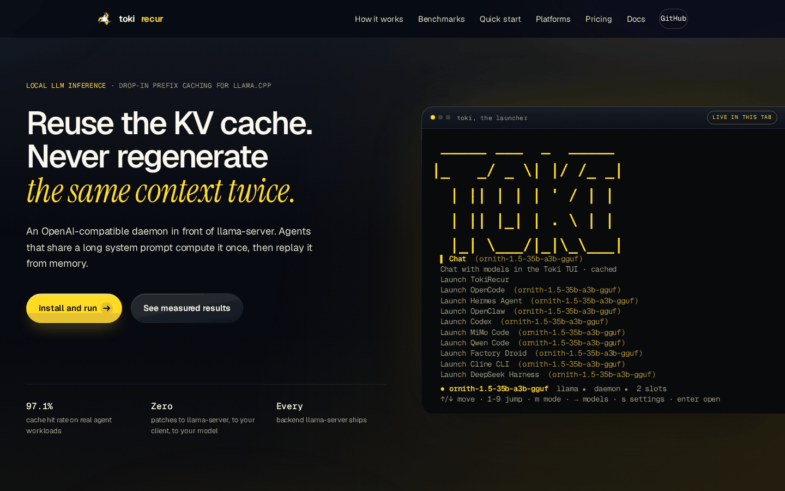

<p align="center">
  <a href="https://tokirecur.com"></a>
</p>

# Toki Recur

KV cache reuse for local LLM inference. Exact prefix matching in front of `llama-server`, across CUDA, ROCm, SYCL, OpenVINO, Vulkan, Metal and CPU.

[](https://github.com/lhadzic377-netizen/TokiRecur/releases)
[](https://tokirecur.com)
[](https://tokirecur.com/docs/)
[](LICENSE)

<p align="center">
  
</p>

<p align="center"><sub><a href="https://tokirecur.com">tokirecur.com</a> — benchmark table, platform matrix, install docs.</sub></p>

## What it does

When a new prompt arrives at an LLM server, the KV cache is rebuilt from scratch — even if 90% of it is identical to a prompt processed moments earlier. Toki Recur embeds the prompt, finds the closest cached prefix, verifies it token-for-token, and routes the request to the slot that already holds that state. An exact prefix match skips prefill; anything else takes the normal path.

Reuse is in memory and lossless: outputs are byte-identical to a no-cache run. Disk persistence was tried and removed — restoring disk KV corrupted precision (88% substantive divergence from baseline in the benchmark), and the `?action=save` / `?action=restore` layer is dormant in the codebase.

## Measured results

Nine workloads across four models (Qwen3.5-9B, Qwen3.6-35B-A3B, Qwen3.6-27B, Qwen3.5-122B-A10B): **TTFT improves 62–96%** and **prefill throughput 410–1280%**, with the biggest gains on the largest MoE models. Full table on [tokirecur.com](https://tokirecur.com).

## What reuse covers: cold vs warm

A prefix cache is only as good as the prefix it can match. Measured with one supported model, one slot, and a long system prompt:

**Setup:** Qwen3.5-2B Q4_K_M · llama-server b1099 (ROCm) · AMD Ryzen AI MAX+ 395 / Radeon 8060S · 8,192-token context · 1 slot · 1,372-token prompt (long system prompt plus a one-line user turn).

| Request | Prompt tokens | Tokens evaluated | Prefill | TTFT |
|---|---|---|---|---|
| Cold (`cache_prompt: false`) | 1,372 | 1,372 | 355 ms | 355 ms |
| Same prompt again | 1,372 | 4 | 27 ms | 27 ms |
| First line of the system prompt changed | 1,377 | 1,377 | 356 ms | 356 ms |

"Evaluated" is `timings.prompt_n` from llama-server: the prompt tokens it actually computed. A warm hit leaves 4 tokens, not zero — the template boundary around the generated answer.

What that means:

- **The match is exact and token-level, not semantic.** Change one token and everything after it is recomputed. Because the system prompt comes first, changing its opening line invalidates the entire prompt.
- **It lives in memory.** A restart, a slot spill or eviction loses it; disk restore was removed. `cache_prompt: false` forces a fresh prefill.
- **It is per model and per slot.** A different model, or a slot holding different contents, cannot serve the prefix.
- **Across harnesses only if the tokens match.** OpenCode and Claude Code carry different system prompts and tool schemas, so switching between them starts cold unless you give both the same prefix.
- **A hit needs at least 10 reused tokens.** Below that it is reported as a `soft_hit`, because save/load overhead exceeds the prefill saved.

These numbers are for interpreting the ratio, not a benchmark: a 2B model at 1.4k tokens. The gain scales with how much stable prefix your harness keeps in front of the changing turn. The daemon's `cache` block in `/v1/chat/completions` is routing metadata (which slot, whether the routing key matched); the token counts above come from llama-server's own `timings`.

## Quick start

Clone and run the installer — cross-platform, no token needed. MIT licensed, public repo.

```bash
git clone https://github.com/lhadzic377-netizen/TokiRecur.git
cd TokiRecur
./install.sh          # Windows: install.bat
```

Both install the `toki` CLI with pipx (auto-installed if missing, venv fallback). The embeddings extra is included by default; skip it with `TOKI_EXTRAS= ./install.sh`. Without pipx:

```bash
python3 -m venv .venv && source .venv/bin/activate
pip install -e .[embeddings]
```

Then fetch a backend, a model, and start it:

```bash
toki model install-llama                        # auto-detect ROCm/CUDA/SYCL/Vulkan/Metal/CPU
toki model pull Qwen/Qwen3-4B-GGUF --name qwen3-4b
toki model use qwen3-4b                         # boots llama-server + daemon, wires CLI clients
toki tui                                       # full-screen chat (or `toki web` for the browser UI)
toki model remove qwen3-4b                     # --purge deletes weights; --force overrides the active-model guard
```

Nothing is installed or started at install time: `toki model use <name>` is the explicit way to bring a model up. `toki up --model <path>` is the single-model equivalent for a raw GGUF without a registry entry. `toki serve` is only the API daemon (default `127.0.0.1:8787`) and proxies to an already-running `llama-server`.

On 8–16 GB machines, `toki model use` reduces context so the KV cache fits beside the weights. The effective context is written to the model's state dir and becomes the single source of truth: the API advertises exactly that number, clamps `max_tokens` to it, and refuses to over-allocate. The floor is 512 tokens.

## Platforms

Pure Python over the `llama-server` HTTP API, on any x86_64 or aarch64 device running Linux, macOS or Windows. The only per-platform piece is the `llama-server` binary itself.

| Platform | Backends | Support |
|---|---|---|
| Linux x86_64 / aarch64 | CUDA, ROCm, SYCL, OpenVINO, Vulkan, CPU | stable |
| macOS x86_64 / arm64 | Metal (runs CPU-only with `-ngl 0`) | stable |
| Windows x86_64 / aarch64 | CUDA, SYCL, Vulkan, ROCm/HIP, OpenVINO, CPU | beta |

- **macOS** ships one universal Metal build; there is no separate CPU asset, and `install-llama --backend cpu` says so rather than claiming a Metal install.
- **CUDA** builds need `cudart`/`cublas`: the installer fetches the matching runtime and proves a real `CUDA0` device line before reporting success. CUDA 13.x needs driver 580.65+, the 12.8 Linux build 570.26+.
- **Linux SYCL** links oneAPI DPC++, oneMKL and Level Zero; **ROCm** uses the system runtime. The installer verifies the libraries and refuses a partial install instead of silently falling back to CPU.
- Windows is **beta**: launcher, chat, tap and every install path are implemented and unit-tested; real-hardware verification is ongoing. CI runs the suite on Linux, macOS and Windows, and executes the Linux/macOS installers end to end.

```bash
toki model install-llama                 # latest release, auto-detected backend
toki model install-llama --backend rocm  # rocm|cuda|sycl|openvino|vulkan|metal|cpu
toki model install-llama --backend rocm --gfx 11.5.1   # HSA_OVERRIDE_GFX_VERSION
toki model install-llama --tag b6400 --name 35b        # pin a release
```

Or point `binary:` at any `llama-server` on PATH in `~/.config/tokirecur/models.yaml`. `TOKI_MODEL_REGISTRY` and `TOKI_STATE_DIR` move the registry and logs/pid/bin.

## Interfaces

Three frontends over one daemon. The API is what agents actually talk to.

| Interface | Command | What it is |
|---|---|---|
| Launcher | `toki` | Full-screen app and model picker; rewrites each client's own config on launch |
| TUI | `toki tui` | Full-screen chat: raw / cached / compare, live TTFT and hit rate |
| Web | `toki web` | Single-page chat on `127.0.0.1:7777`, streaming, per-message metrics |
| API | `toki serve` | OpenAI-compatible `/v1/chat/completions`, plus Anthropic and admin routes |

The launcher starts Toki Chat, OpenCode, MiMo Code, Hermes, OpenClaw, Codex, Qwen Code, Factory Droid, Cline CLI, DeepSeek Harness, Grok Build, Kilo Code, Pi, GitHub Copilot CLI, Kimi Code, OMP and Claude Code, all pinned to the active model. OpenAI-compatible clients use the daemon's OpenAI route; Claude Code uses the local Anthropic-compatible `/anthropic/v1/messages` route with an owner-only settings override. The override carries the local token as `ANTHROPIC_AUTH_TOKEN` — not as `ANTHROPIC_API_KEY`, because Claude Code sends an API key only after it has approved it, and falls back to another credential when it has not: on a machine with a cloud provider configured, that credential belongs to that provider and the local daemon answers 401 for it.

```bash
toki tui                                  # raw / cached / compare: Ctrl+1 / 2 / 3
toki web --port 7778 --tls-cert cert.pem  # HTTPS + wss
toki diff --system "<long system>" "<prompt>"   # one-shot raw/cached A/B
```

Claude Code sends tens of thousands of tokens per prompt with its full setup. `TOKI_CLAUDE_BARE=1` launches `--bare`, `TOKI_CLAUDE_MCP=none` an empty MCP config, and `TOKI_CLAUDE_EFFORT=low` a smaller effort budget.

On a slow box — a laptop with no usable GPU, where the profile says `cpu` — the launcher also gives Claude Code a 30-minute budget (`API_TIMEOUT_MS`, `CLAUDE_STREAM_IDLE_TIMEOUT_MS`) instead of its 10-minute default, because a CPU prefill of a long prompt can spend that on its own. `TOKI_CLAUDE_TIMEOUT_MS` overrides it in milliseconds. The daemon waits longer than the client by default (`TOKI_BACKEND_TIMEOUT`, 1800 s) so it is never the side that gives up first, and it says what the wait will cost: the measured prefill rate per model becomes the estimate it puts in the first stream event and the log, so a slow turn is a number instead of a mystery.

## Command reference

```bash
# stack
toki up [--detach] [--skip-llama] [--model PATH --ctx-size N]
toki down | toki status

# models
toki model install-llama [--backend B] [--tag T] [--name N]
toki model pull <hf-repo> --name <short>     # any GGUF on Hugging Face
toki model use <name> | toki model remove <name> [--purge] [--force]

# chat
toki | toki tui | toki web [--detach] [--port N]
toki diff --system "<long>" "<prompt>"

# benchmark
toki bench                                   # interactive: model + workload
toki bench --model 9b --workload agent_long_context --max-tokens 64 --output-json report.json

# cache and diagnostics
toki stats | toki evict --target-mb 4096
toki doctor | toki hardware

# training data (off by default)
toki tap on | status | off
toki tap export --format sft --out training.jsonl
```

API, on `http://127.0.0.1:8787` while `toki up` is running:

```
POST /v1/completions          POST /v1/chat/completions
POST /cache/lookup            GET  /cache/stats
DELETE /cache/{id}            GET  /healthz
```

`toki model use` also writes MiMo Code's `mimocode.json` provider config; MiMo then selects the same model with `mimo -m tokirecur-<model>/<model-id>`.

## How it works

```
┌─────────────────┐      ┌──────────────────┐      ┌────────────────┐
│  Client / agent │ ───► │  toki (daemon)   │ ───► │  llama-server  │
│  (OpenAI API)   │      │                  │      │   (ROCm/HIP)   │
└─────────────────┘      └──────────────────┘      └────────────────┘
                         │  embedding + index │
                         │  SQLite + blobs    │
                         └────────────────────┘
```

The daemon embeds the prompt, finds the most similar cached prompt, verifies an exact prefix match on token IDs, then either restores the KV state and decodes only the novel tokens, or prefills and records the state for the next request.

Beyond the base cache:

- **Tree-structured KV** — blocks are content-addressed by token hash, so two prompts sharing a prefix share blocks; tree lookup can bypass embedding entirely.
- **Persistent slot pool** — the top-N hottest prefixes get dedicated slots that never clear.
- **Honest hits** — a hit requires at least 10 reused tokens; below that the save/load overhead exceeds the prefill saving, and it is reported as a `soft_hit` instead of inflating the rate.
- **Prefix-weighted similarity** — among candidates within 5% cosine similarity, the longest token list wins.
- **Divergence classification** — outputs are graded identical / whitespace / restore-noise / substantive by semantic similarity.
- **Embedding chunking** — long prompts are split into overlapping segments, with a deterministic hash fallback.

`patches/` keeps a historical patch for older llama.cpp builds; current upstream already exposes the slot endpoints behind `--slot-save-path`.

## Production deployment

llama-server, the daemon and the web UI ship as systemd units in `packaging/systemd/`. One `TOKI_AUTH_TOKEN` from a `chmod 600` env file gates both the daemon and the web UI.

```bash
sudo install -m 600 packaging/systemd/toki.env.example /etc/toki-recur/toki.env
# edit: TOKI_AUTH_TOKEN=<token>
sudo install -m 644 packaging/systemd/toki-recur.service packaging/systemd/toki-recur-web.service /etc/systemd/system/
sudo systemctl daemon-reload
sudo systemctl enable --now toki-recur toki-recur-web
```

The web UI has no login page and no session cookie, which is fine on the default `127.0.0.1` binding. If you expose it, serve HTTPS + `wss://` with `--tls-cert` / `--tls-key` (or `TOKI_WEB_TLS_CERT` / `TOKI_WEB_TLS_KEY`). It refuses cross-origin requests and sends `Cache-Control: no-store`; the daemon token is never weakened by an open UI.

## Use it as an opencode backend

The daemon's `/v1/chat/completions` is OpenAI-compatible and tool-calling capable, so opencode can run entirely on the local model, reusing the previous turn's prefix.

```jsonc
// ~/.config/opencode/opencode.json
{
  "provider": {
    "tokirecur": {
      "name": "Toki Recur (KV-cache, local)",
      "npm": "@ai-sdk/openai-compatible",
      "options": {
        "baseURL": "http://127.0.0.1:8787/v1",
        // the token the daemon runs with: cat ~/.config/tokirecur/auth
        "apiKey": "<token>"
      },
      "models": {
        "qwen3.5-9b": {
          "name": "Qwen3.5 9B (Toki Recur)",
          "contextWindow": 24000,
          "limit": { "context": 24000, "output": 8192 }
        }
      }
    }
  },
  "small_model": "tokirecur/qwen3.5-9b"
}
```

`apiKey` must be the real `TOKI_AUTH_TOKEN`; a placeholder is not a secret. The model id is a label — the weights are whatever `llama-server` has loaded — and `contextWindow` should stay under `TOKI_MAX_CONTEXT_TOKENS`. Tool calls stream through verbatim, end with `finish_reason: "tool_calls"`, and `role: "tool"` messages round-trip unchanged.

## Benchmark

`toki bench` runs baseline (no cache) against recycled (cache on) on the same prompt set and scores TTFT, prefill throughput, end-to-end latency, hit rate and output equivalence. The composite is weighted toward production impact rather than wall-clock:

| Component | Weight |
|---|---|
| Prefill skip | 30% |
| TTFT improvement | 25% |
| Throughput gain | 20% |
| Cache hit rate | 15% |
| Output equivalence | 10% |
| Wall-clock gain | 5% |

Grades: A+ ≥ 90, A ≥ 80, B ≥ 70, C ≥ 60, D ≥ 50, F < 50. Workloads range from `realistic_mixed` (201 prompts across five traffic types) and `stress_adversarial` (301 adversarial prompts) to `agent_long_context`, `rag_chunks`, `mixed` and `no_overlap`.

## Recording turns (`toki tap`)

Off by default. With it on, the daemon appends one JSONL line per managed turn to `~/.local/state/tokirecur/tap/YYYY-MM-DD.jsonl`: the prompt, the answer, the reasoning and the turn's numbers. Nothing leaves the machine. `toki tap export --format sft` writes `{"messages": [...]}` lines a trainer accepts. Limits: images are recorded as the captions the model was shown, not as pixels, and token ids are not recorded.

## Repository layout

```
tokirecur/
├── src/tokirecur/
│   ├── core/        # recycling engine, the 5-step algorithm
│   ├── index/       # brute-force + HNSW index, SQLite metadata
│   ├── backend/     # llama-server HTTP adapter
│   ├── cache/       # KV blob storage and slot pool
│   ├── api/         # FastAPI: OpenAI + Anthropic + admin routes
│   ├── bench/       # the benchmark CLI
│   ├── cli/         # `toki` admin CLI
│   ├── tui/         # full-screen launcher and chat
│   └── web/         # single-page chat UI
├── packaging/       # systemd units
├── patches/         # historical llama.cpp patch
├── docker/          # ROCm image + compose
├── scripts/         # installers and build helpers
├── tests/           # unit, integration, benchmarks
└── benchmark/       # configs, reports, corpus
```

## Tests

```bash
pytest tests/unit/ -v        # fast, no llama-server needed
pytest tests/ -v             # includes integration (needs a live llama-server)
```

285+ unit tests cover the recycling engine, the index, the rate limiter, the tree cache, the slot pool and the `.trkv` format. CI runs the unit matrix on Python 3.11 / 3.12 / 3.13 on every push and PR.

## License

MIT — see [LICENSE](LICENSE). Copyright (c) 2026 Luke Hadzic.

`patches/` modifies [llama.cpp](https://github.com/ggerganov/llama.cpp), MIT licensed (c) 2023-2026 The ggml authors — full text in [LICENSE.llama-cpp](LICENSE.llama-cpp).

## Support

Questions and security reports: <contact@tokirecur.com>.
